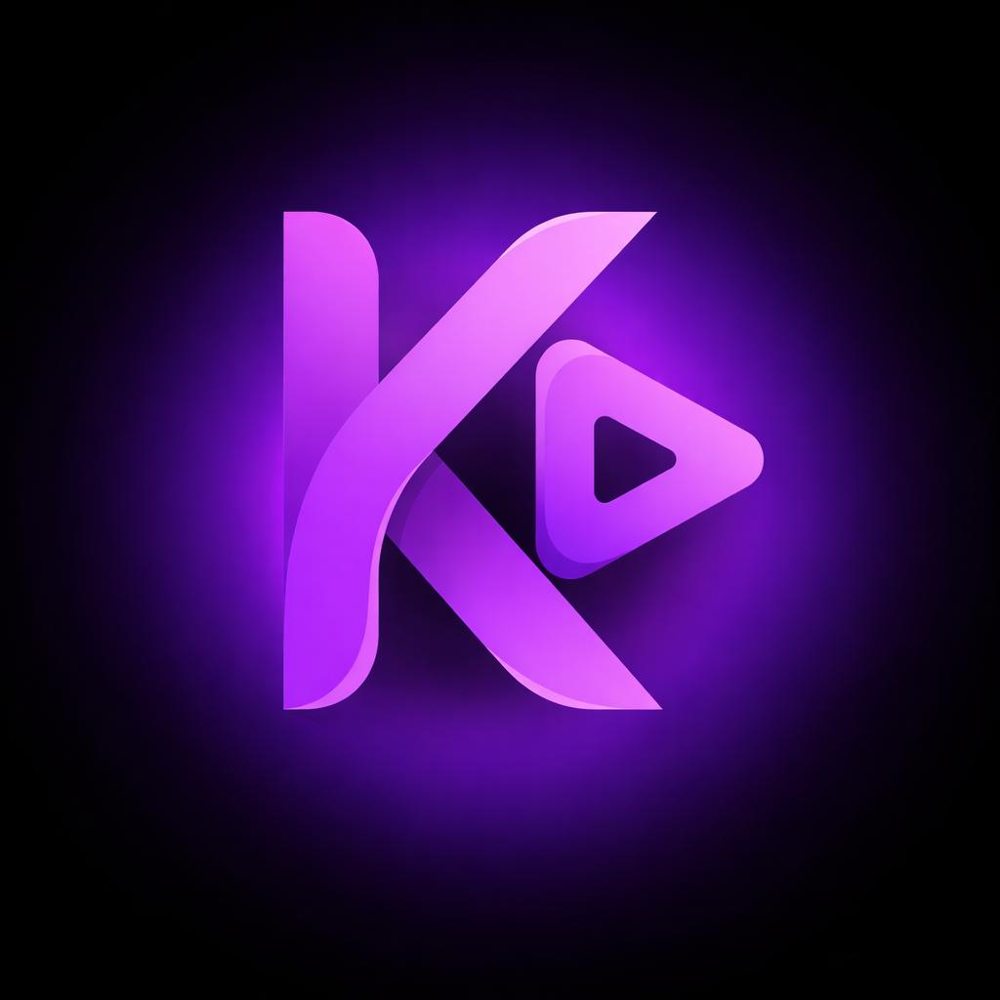

# 🎬 KapFlix

<p align="center">
  
</p>

<p align="center">
  <b>Cinema-grade streaming browser for Movies & TV Shows.</b><br>
  Built with React 19, TypeScript, Vite, and Tailwind CSS. Inspired by the deep obsidian aesthetic of Vivarium.
</p>

<p align="center">
  
  
  
  
  
</p>

---

## ✨ Features

* **High-End Obsidian & Frosted Glass Palette:** Built with Vivarium's design language (`#080808` canvas, hardware-accelerated transforms, blurred glass panels, and dynamic ambient mood lighting).
* **Cinematic Splash Screen:** Pulsing brand mark and smooth fade-out during initial catalog preparation.
* **Unified Media Catalog:**
  - **Movies:** Trending, popular, top-rated, and genre-curated cinema powered by TMDB.
  - **TV Shows:** Complete series browsing with multi-season drawers and episode previews (16:9 stills, air dates, runtimes).
* **Trailer & Backdrop Player:** High-resolution backdrops and integrated official YouTube trailer modals in one click.
* **Smart Explore & Filter:**
  - **By Studio:** A24, Warner Bros, Universal, Marvel Studios, Paramount, Sony.
  - **By Network / Service:** Netflix, HBO/Max, Disney+, Apple TV+, Amazon Prime.
  - **By Genre, Era & Rating:** Filter by genre, release decade/year, and minimum rating (★ 8.0+, ★ 7.0+).
* **"More Like This" Recommendations:** Contextual recommendations row inside every movie and series details panel.
* **Global Release Calendar:** Live timeline of upcoming theatrical premieres and television air dates with calendar badges.
* **Instant Keyboard Search:** Press `/` anywhere to launch the blurred search overlay with instant debounced matching.
* **Resilient Multi-Server Player:**
  - 4 built-in stream providers (`VidLink`, `VidSrc`, `EmbedSu`, `MultiEmbed`).
  - One-click server switching with automatic episode/season retention.
  - Previous / Next episode floating quick controls.
* **Zero-Cloud Local Persistence:**
  - **Continue Watching:** Automatically captures your last watched episode, title, and timestamp.
  - **My List (Watchlist):** One-click toggle stored directly on-device in `localStorage`.
* **Multi-Platform Ready (Linux, Windows, Android):** Ships with PWA `manifest.json` for standalone desktop/mobile installation, and pre-structured for **Tauri v2** native builds.

---

## 🛠 Tech Stack

| Layer | Technology |
| :--- | :--- |
| **Framework** | [React 19](https://react.dev/) + [TypeScript](https://www.typescriptlang.org/) |
| **Build Tool** | [Vite 6](https://vitejs.dev/) (Sub-second HMR & production bundle) |
| **Styling** | [Tailwind CSS](https://tailwindcss.com/) with frosted glass utilities |
| **Metadata APIs** | [The Movie Database (TMDB)](https://www.themoviedb.org/) |
| **Storage** | Client-side `localStorage` (Private, zero server cost) |
| **Testing** | Node built-in test runner (`node:test` + `node:assert`) |

---

## 🚀 Getting Started

### Prerequisites

* Node.js v18+ (tested on Node v20/v26)
* npm or pnpm

### Installation

```bash
# Clone the repository
git clone https://github.com/your-username/KapFlix.git
cd KapFlix

# Install dependencies
npm install

# Start development server with instant HMR
npm run dev
```

Visit `http://localhost:3000` in your browser.

---

## 📦 Scripts

| Command | Description |
| :--- | :--- |
| `npm run dev` | Starts the Vite development server on port 3000 |
| `npm run build` | Compiles TypeScript and builds optimized production bundle to `dist/` |
| `npm start` | Runs the zero-dependency Node static production server |
| `npm test` | Runs the test suite covering stream generation and storage |

---

## 📱 Cross-Platform Installation (Linux, Windows, Android)

### Option 1: Progressive Web App (PWA)
1. Run `npm run build && npm start`.
2. Open `http://localhost:3000` (or your deployed URL) in **Chrome**, **Edge**, or **Brave**.
3. Click the **Install** button in the URL bar (or *Add to Home screen* on Android).
4. Launches standalone with an app icon, zero browser borders, and dedicated taskbar/drawer entry.

## 📱 Android Phone & Android TV (Full D-Pad Remote Support)

KapFlix includes a native universal Android wrapper (`android/`) compatible with **Android Phones**, **Tablets**, and **Android TV / Google TV / Fire TV**:

* **Universal Launcher:** Supports both standard mobile home screens (`LAUNCHER`) and Android TV Leanback (`LEANBACK_LAUNCHER`).
* **Full D-Pad & Remote Navigation:** Seamless 2D spatial navigation across shelves, cards, floating navbar, and player controls using TV remote directional arrows (`Up`, `Down`, `Left`, `Right`), `OK` (Enter), and `Back` (Escape).
* **High-Visibility TV Focus Rings:** Automatic glowing focus states (`focus-visible`) optimized for 10-foot TV viewing.
* **Over-The-Air (OTA) Updates:** Hot-reloads updated web bundles seamlessly in the background without requiring APK re-installation.
* **Hardware Acceleration:** Native 60/120fps video rendering via hardware-accelerated Android WebView.

### Building Android APK Locally:
```bash
# 1. Build web bundle and sync assets into Android project
npm run build:android

# 2. Compile APK with Gradle
cd android
chmod +x gradlew
./gradlew assembleRelease
# Output: android/app/build/outputs/apk/release/app-release-unsigned.apk
```

---

## 🤖 GitHub Actions CI/CD (Auto-Build & Release)

The repository includes an automated GitHub Actions workflow (`.github/workflows/build-and-release.yml`):

1. **Automated Testing & Web Build:** Runs on every push to `main` and pull request.
2. **Android Universal APK Compilation:** Automatically compiles `KapFlix-Universal-release.apk` with Java 17 and Android SDK on GitHub runners.
3. **Automated GitHub Releases:** When you push a git tag (e.g. `git tag v1.0.1 && git push origin v1.0.1`), GitHub automatically creates a release with the APK and web bundle attached.

---

## 🔄 Over-The-Air (OTA) Hot Updates

KapFlix ships with an integrated OTA update engine:
* The app automatically queries `/version.json` on startup.
* When a newer web release is detected, a floating pill banner notifies: `🚀 Update v1.0.1 Ready [Update Now]`.
* Clicking **Update Now** swaps the Service Worker cache and hot-reloads the application instantly without re-downloading the APK!

---

## ⚖️ Legal & DMCA Disclaimer

KapFlix is a client-side user interface and search index for third-party media metadata. 

* **No Media Hosted:** KapFlix does not host, upload, store, archive, or transmit any video files, media streams, torrents, or copyrighted audiovisual content.
* **Third-Party Sources:** All movie/show metadata is fetched via TMDB and AniList APIs. Video playback occurs entirely via third-party iframe embeds over which KapFlix exercises no technical or operational control.

For formal copyright inquiries and DMCA takedown procedures, please read [DMCA.md](DMCA.md).

---

## 📄 License

Distributed under the [MIT License](LICENSE).
